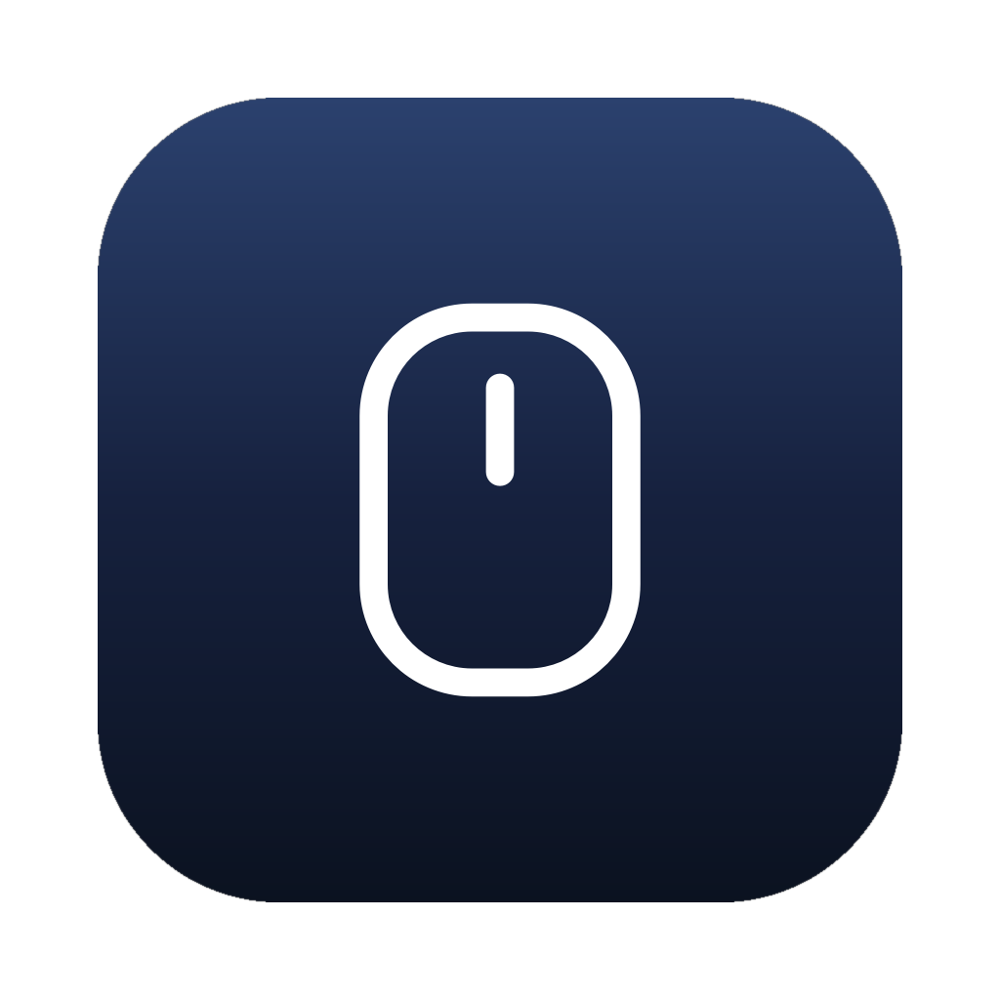
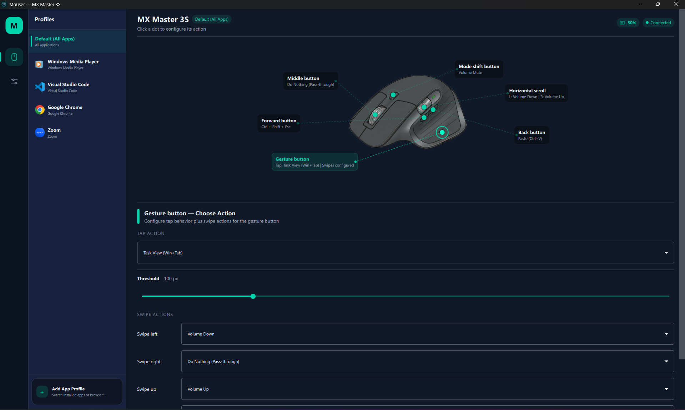
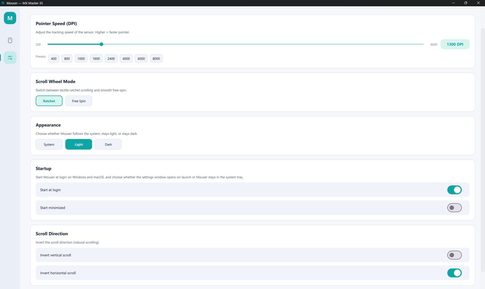

# Mouser — 罗技鼠标按键映射工具

> 非官方 G502 系列修改版。
>
> 本仓库基于原开源项目 Mouser 修改而来：
> [https://github.com/TomBadash/Mouser](https://github.com/TomBadash/Mouser)。
> 原项目使用 MIT License，本修改版保留原版权声明和许可证。
>
> 这个版本主要补充 Logitech G502 系列支持，尤其是 G502 HERO
> (`046D:C08B`)：新增/修正设备识别、G502 可视化布局、DPI/Profile
> 特殊按键的板载 F13–F16 解锁方案、动作环和状态提示中文化、用户配置
> 备份/导入/导出，以及启动时不弹出终端窗口的 Windows GUI 打包。

## G502 系列修改版说明

### 3.7.61 本地测试版：截图组件按需安装

主程序仅保留鼠标配置、普通截图、编辑、贴图和图片浏览／缩放。
长截图引擎和文字选择改为独立可选组件；不用这些功能就不必安装。

- 首次使用长截图／文字选择时打开安装提示，用户确认后才安装，不静默下载。
- **设置 → 截图 → 截图组件** 可查看状态、下载安装、导入离线 ZIP 或卸载。
  优先使用程序旁 `可选截图组件` 文件夹中的匹配 ZIP，缺少时才尝试线上下载。
- 此本地测试版的组件尚未上线，因此附有离线 ZIP；不会把未发布链接当成可用下载源。
- 已安装组件保存在 `%LOCALAPPDATA%\Mouser\screenshot_components`，更换主程序目录
  后仍可使用；卸载组件不删除个人快捷键。与主程序相邻的旧文字组件仍可使用，
  显式安装时可校验后复制到独立目录，原目录不动。
- 长截图计算仍在会话子进程中；普通截图和长图编辑、贴图、滚轮浏览、Ctrl＋滚轮缩放
  不依赖长截图引擎。文字选择仍仅在用户点击后本地处理，不上传图片。
- ZIP、清单及每个组件文件均有固定校验；安装失败／取消保留原有组件。
  正在使用的组件不允许卸载或覆盖。

本版尚未替换 GitHub 正式下载，也不会自动退出正在运行的旧版或修改开机启动路径。
组件全装时总磁盘占用不保证下降；主要减少主程序下载和不使用相关功能时的占用。

### 3.7.60 Windows x64 发布候选包

源码已同步仓库，但 Release 二进制上传受网络策略限制；不能从
[现有正式 Release](https://github.com/meiyoutou/Mouser-G502/releases/latest)
推定能下载此版本。本地候选包完整解压后运行 `Mouser/Mouser.exe`。
保留 `Mouser.exe`、`_internal`；使用文字选择时，还需同级的 `文字选择组件`。
正式包只含运行文件和必需许可证，不附带测试图片、测试说明、个人配置、日志或录音。

- 区域／全屏截图支持标注、马赛克、保存、独立贴图和自动拼接长截图。
- 长截图对号结束拼接后先进入已有编辑器，编辑器对号再复制／保存。
- 贴图和长图编辑器均为 **Ctrl＋滚轮缩放，普通滚轮上下浏览**；
  有放大／缩小按钮，贴图右下角可拖动调整窗口大小。
- 编辑器 **更多 → 文字选择**，准备完成后拖选、Ctrl+C 复制，Ctrl+A 全选。
  沿用约 16 MB 的轻量本地组件，仅在点击时运行，不上传图片，仍可能有错字。
  缩放保留文字坐标，标注／遮挡后清除旧坐标；图片输出不带选字高亮。
- 保留严格罗技身份校验、接收器多槽设备识别、重连和个人配置备份／导入／导出。
- 语音仍为按需安装：公共运行库 v2 和模型不随主程序捆绑。
  在线安装使用固定大小及 SHA-256 校验；已有本地组件包时优先本地安装。
- 保留线程限制、计算子进程随会话退出、设置界面延迟加载／释放及有界日志。
- 检查更新和更新清单均使用本修改版仓库；原项目链接和 MIT 版权声明保持不变。

更换程序无需重建快捷键，个人配置继续保存在 `%APPDATA%\Mouser`，
已安装语音组件保存在 `%LOCALAPPDATA%\Mouser`。不把个人数据放进公共仓库。
发布前有自动回归和最终 exe 合成图检查，但不保证所有第三方页面、多屏硬件、
长期运行和真实麦克风识别效果。下方各本地测试版段落仅为历史记录。

### 3.7.56 本地测试版：第二轮生命周期优化

长截图的匹配计算改为会话独立子进程：首次有画面变化才启动，完成或取消后退出，
让 NumPy / OpenCV 随子进程释放。主进程继续使用原有拼接、内容裁切、撤销、
最后一屏补采和像素校验逻辑；选区图像只通过内存管道传递，不新增截图落盘。
首次匹配存在子进程启动与帧传输开销；计算时的总内存不保证减少，主要改善结束后的驻留。

托盘启动时先不创建设置界面，打开设置时才加载；关闭到托盘 60 秒后，
若没有未保存语音词表/修正词或录入对话框，则释放 QML 窗口。
再次打开会重建并恢复页面与窗口位置大小，因此可能有短暂重建延迟。
有未保存内容时保留界面，避免自动清空；不卸载已安装模型。

设置不可见时停止每 500 ms 的 UI 设备清单快照刷新；鼠标识别、发现、重连、
快捷键、语音和截图服务保持运行。仍是独立本地测试包，不自动替换运行中的旧版，
不修改个人配置或开机启动，不清理旧包，也未上传 GitHub。

### 3.7.55 本地测试版：第一轮资源优化

长截图首次按需加载计算库时，将 OpenBLAS 限为 1 线程、OpenCV 限为 2 线程，
避免多核电脑为未使用的线程申请大量提交内存；不修改拼接算法、匹配阈值或清晰度。
仅在库初始化期间临时设置进程环境，随后恢复，语音子进程不继承此限制。
移除包内未使用的 FFmpeg 视频解码、AVIF、非 Material 的 Controls 样式；
保留 Basic 回退、QtOpenGL 和既有 Windows DLL 兼容修复。

日志默认 INFO，原有“调试模式”仍可启用 DEBUG；新生成的主日志最多约 4 MiB，
语音事件日志最多约 768 KiB，不记录录音和识别原文。旧日志不在本轮清理。
这是独立本地测试包，不改个人快捷键、已安装模型或系统启动项，不删除旧包、不上传 GitHub。
未实施后台 UI 销毁、长截图子进程或整屏缓冲重构；后续按实际体验分轮评估。

### 3.7.54 本地测试版：统一“文字选择”，移除旧 OCR

区域/全屏截图框定范围后，点击 **更多（…）→ 文字选择**，准备完成后在图片
文字上拖选、Ctrl+C 复制，Ctrl+A 全选。图标改为统一线宽的“文字行 + I 形光标”，
入口和提示跟随简中、繁中、英文设置，不再显示“小模型测试”等旧名称。
默认鼠标选择和文字标注仍为独立工具，对勾仍输出图片。

旧 RapidOCR / PP-OCRv6 的入口、安装器、结果弹窗、组件目录清单及打包脚本已移除；
新版只有一个文字选择入口。旁边约 16 MB 的 `文字选择组件` 保留 Tesseract
轻量识别引擎，手动启用时才在短生命周期子进程运行，不常驻、不上传、不自动粘贴。
它底层仍是 OCR 技术，可能有错字，复制后应核对；不是让原软件按钮可点击。
目前适用于区域和全屏截图，长图结果及独立贴图尚未接入文字层。

这是独立本地测试包，不自动切换运行中的旧版，不修改个人配置或开机启动，
未上传 GitHub。下方各版本段落是历史记录，其中旧 OCR 操作说明不适用于新版。

### 3.7.51 本地测试版：默认选择是普通鼠标指针，不是框选

默认“选择”改为普通箭头图标与鼠标指针，不再是虚线框或十字光标。
首次截图仍正常框定范围；松手进入编辑后，默认指针点击／拖动选区内外空白处
都不会重新划框、移动选框或偷偷裁剪图片。长图结果编辑器也保持同样语义。
小手点击后仍可在选区内部拖动选框，边缘控制点仍可调整大小，独立贴图仍可自由移动。

普通指针仅作用于截图编辑界面，不穿透点击原软件，不将冻结图片中的按钮或文字
变为可交互控件／可选择文本，不自动 OCR。本地测试包，配置与旧版保留，未上传 GitHub。

### 3.7.50 本地测试版：默认选择，小手点击切换移动模式

工具条新增“选择（默认）”，每次截图默认选中。点一下旁边的小手，再到
选区内部任意位置按住鼠标拖动，即可移动选框；不用长按小手图标，
松开后仍保留移动模式，可以反复拖动。两种工具互斥并有蓝色选中底色。
点回“选择”或右键，即恢复默认选择模式；拖边缘控制点仍可调整大小。

只移动选框，冻结截图与已有标注仍留在原屏幕坐标；移动不会越出桌面边界，
也不会越拖越大。贴图仍是独立功能，图片本身可以自由拖动。
没有自动贴图或 OCR，不重置快捷键、不修改个人配置。本地测试包，未上传 GitHub。

### 3.7.49 本地测试版：小手放在框选阶段，截图与贴图区分

纠正 3.7.48 的交互位置：框选松手后立即保持冻结画面，截图工具条最左侧
直接出现小手拖动柄，不必先点对勾，也不需要进入贴图。
默认拖选区内部不再挪动选区；拖小手调整选区位置、拖边缘控制点调整大小，
背景截图与标注始终留在原屏幕坐标，不会变成漂浮图片。复制仍是图片，不自动 OCR。

撤掉“完成后自动贴图”：普通与长截图点对勾仍正常复制／保存并结束截图。
只有明确点击“贴图”才创建独立贴图；贴图可从图片任意位置拖动，也可拖动空白
边栏或小手自由移动，不受截图选区的边界限制。
此前长截图配准、原图复制与可选组件保持不变。

此流程在“截图后编辑（Windows）”开启时生效；关闭该选项仍按原设置立即输出。
本地测试包，保留旧版和个人快捷键，未自动修改开机启动项或上传 GitHub。

### 3.7.48 本地测试版：截图默认固定显示，增加小手拖动柄

区域、全屏和长截图完成复制／保存后，默认保留一张固定贴图，不再立即消失。
上方只有小手拖动柄、复制和关闭按钮；拖动小手移动整张截图，复制按钮仍输出
完整原始清晰度图片，不包含操作条，不是只复制当前看到的一截。
长图按宽度适应可滚动窗口，普通滚轮上下查看，Ctrl+滚轮缩放。

没有增加或自动触发文字识别，不需要安装 OCR／语音组件；这里复制的是图片。
贴图不抢原输入框的键盘焦点，使用按钮复制；不提供全局 Ctrl+C 劫持。
提示和按钮说明跟随设置语言变化。原有按键绑定、截图复制／保存目的地不变，
取消或输出失败不新增贴图。原手动贴图功能仍可用。

最多保留 8 张贴图，超过时关闭最早的一张；贴图只在本次运行中保留，
关闭或退出不会自动写入截图文件，原“保存”类动作仍会正常保存。
本地测试版，旧版与个人配置保留，不自动上传 GitHub。

### 3.7.47 本地测试版：真实 Codex 样本回放与重叠区更新

3.7.46 的用户本机诊断已经接上：保存的 8 张画面中，7 次追加均成功，
重现累计 1000 像素位移；原完整会话结果为 930×5991。因诊断只保存前 8 帧，
不能据此宣称离线重放了整个原会话，或已验证所有第三方软件。

样本同时确认旧拼法会把固定的“跳到底部”箭头重复留下。现改为在已验证的
重叠区接缝、更新旧尾部，利用下一张画面里真实露出的像素覆盖旧按钮。
同一批保存样本中，重复箭头从 7 处降为最后画面中的 1 处，位移和正文范围不变；
不涂抹、不生成被遮住的文字。最后一屏仍被遮住的内容无法凭空恢复。
预览仍只有缩略图与取消／对勾，不增加操作步骤，普通截图编辑不变。

这是本地测试包，未自动替换运行程序或上传 GitHub。真实聊天图片和回放结果
仅存于用户本机诊断目录，不加入源码、主程序资源或公共 ZIP；回归使用生成图片。

### 3.7.46 本地诊断版：真实选区取样，不把系统候选区当作纯正文

修正“系统给出聊天容器后，程序反而关闭图像固定框排除”的逻辑。
系统候选区仍可能含固定顶栏和输入框，现继续做像素区域细化。
真实 Codex 场景尚待手动取样验收，本地测试版未上传 GitHub。

本地包增加 `Mouser-Scroll-Diagnostic.exe` 独立诊断入口（也可用
`Mouser.exe --diagnose-scroll`）。它在日志、配置、鼠标引擎和单实例处理前启动，
可与原鼠标程序并行。必须手动勾选保存说明并框选；不替用户滚动或输入。
最多保存 8 张完整手动选区的前后图及元数据，含相邻固定框，位置为
`%LOCALAPPDATA%\Mouser\scroll_diagnostics`。不写剪贴板、不上传，不默认开启。
取消也保留已记录的样本，普通截图取消行为不变；分享前请检查聊天隐私。

### 3.7.45 本地测试版：新匹配核心与纯缩略图实时预览（Windows）

当前长截图会话改用 OpenCV 图像配准，不再以旧的整行完全相等匹配为主。
多列模板与 ORB 特征只提出位移；重叠区细节、颜色和歧义复核通过后才追加，
空白或完全重复的内容不强行猜接。OpenCV/NumPy 已随主程序打包，
不需要安装语音、OCR 组件或下载模型，第三方许可见 `THIRD_PARTY_NOTICES.md`。

针对“一边固定框、一边滚动框”的选区，尝试从前后画面的变化限定滚动正文，
不把固定框反复拼进长图；不控制鼠标或替用户滚动。
框选 → 长截图 → 在滚动框滚动 → 点对勾，直接按原截图动作复制或保存。
预览面板只显示实时缩略图、取消和对勾图标，无标题栏、说明或进度文字。
拖动缩略图可以移动面板，预览刷新不暂停、不抢焦点。
识别失败保留已有画面，略微回滚可恢复；未接上时缩略图边框为琥珀色，
悬停可查看按设置语言显示的原因。普通截图仍保留原位编辑功能。

本地测试版；保留个人配置和旧版，不自动上传 GitHub。真实第三方窗口的
适配效果仍需用户测试，合成/自建窗口通过不等于已验证所有应用。

### 3.7.44 本地测试版：无系统滚动识别时的画面位移后备（Windows）

修复实际日志确认的情况：系统未识别出正文，整块选区不断提示“未接上”，
看起来只有第一张。保留系统几何识别，同时增加不依赖系统接口的画面位移分析，
从前后两张选区图片寻找真正移动的区域，自动排除固定面板。
无需安装新模型或图像处理组件，不读取正文或标题，不控制目标滚动。

候选区域必须解释绝大部分画面变化，不能裁掉变化的数字来凑匹配；
无法唯一定位的重复内容仍拒绝。未知区域不再靠很低的平均灰度误差猜测位移，
避免轻微重绘被误当作滚动。识别后使用内部区域匹配、替换旧底部边缘，
防止白色固定边缘在每条接缝反复出现；保留撤销和重新接续。

开始后缓慢向下滚动；识别成功时提示“已限定到可滚动正文”。
完全重复、动画或重叠不足仍可能失败，此时回滚恢复重叠，或重新仅框选正文。
禁用系统识别的自建窗口通过连续 10 次原生采集拼接，共 1070 像素，
正文与已知原始像素一致；不代表已验证用户的 Codex 窗口。
仍是单屏向下滚动，本地测试，不改个人配置、当前程序或 GitHub。

### 3.7.43 本地测试版：识别滚动正文，避开固定面板（Windows）

针对聊天窗口包含固定侧栏、顶栏、底部输入框时持续提示“未接上”的问题，
开始长截图时尝试通过系统无障碍接口识别真正滚动的正文。
支持标准滚动容器，以及部分没有声明滚动模式、但有正文与相邻滚动条的 Qt 界面。
只读取控件几何和滚动能力，不读取正文或标题，不控制目标滚动。
检测结果只缩小、不扩大手动选区；识别成功时控制条提示“已限定到可滚动正文”，
最终长图只包含该正文。首帧和后续帧使用完全一致的物理像素区域。

原始像素匹配增加分区一致性验证，容忍窄滚动条、闪烁光标等小范围变化；
不能可靠区分的重复内容仍拒绝，避免错拼。
探测在后台限时进行；目标不支持、超时或失效时保留原选区，
此时请重新只框选正文，不包含固定顶栏、输入框或动画。
这不是任意固定栏的像素自动删除，也不保证所有第三方程序均支持。
仍是单屏、手动向下滚动、自动拼接；本地测试，不改个人配置、当前程序或 GitHub。

### 3.7.42 本地测试版：滚动即自动拼接（Windows）

框选区域 → 点击长截图 → 在原窗口缓慢向下滚动 → 点对勾结束并标注。
不再点击“追加一屏”；程序只在这次长截图会话中自动采样、匹配和追加，
不会替你滚动页面，也不会在退出长截图后继续采集。
控制条不抢原窗口焦点，使用 Windows 捕获排除功能防止控制条进入长图。
如果系统无法排除且控制条挡住选区，会暂停并提示移出选区。

暂停/继续可临时停止捕获；预览和撤销会自动暂停，防止刚撤销的内容又被添加。
结束时会检查最后未采样的画面；若最后一段未接上，先暂停提示，
可以向上回滚后继续，或再次点对勾明确只保留已拼接部分。
匹配在后台按顺序进行，不堆积任务；静止画面不会反复拼接或刷失败日志。
仍限单屏向下滚动，需保留重叠、避开固定栏和动画；
暂不支持固定栏自动去除、向上追加或跨屏长截图。
高度 20000 像素、3200 万像素的限制不变，细碎更新最多 500 次。
本地测试版，不更改已有快捷键配置、当前运行程序、开机启动项或 GitHub。

### 3.7.41 本地测试版：长截图文字页拼接修复（Windows）

修复已复现的“白底文字页有明显重叠，却误报无法拼接”：
优先按原始 RGB 像素行寻找重叠并核对完整像素，避免缩成窄灰度图后丢失文字差别。
存在多个真实重叠位置时仍拒绝冒险拼接；完全未滚动、重叠不足或截图尺寸变动时，
保留已有长图并提示重试。增加普通文字页、小幅滚动、多次追加/撤销等测试。
日志仅记录追加尺寸、行数和失败原因码，不写入截图文字或图像。
长截图仍是单屏、手动向下滚动后点击“追加一屏”；本次没有自动滚动、
自动追加或去除固定标题栏，选区仍需避开固定栏和动画。
只交付本地测试版，不改个人配置、当前运行程序、开机启动或 GitHub。

### 3.7.40 本地测试版：精简截图按钮与统一图标（Windows）

移除“编号”“完整图片”和重复的“选区／裁剪”按钮。截图仍直接框选、拖边调整；
标注后右键或再点当前工具回到选区模式。悬停自动框选窗口本次未改动。
主栏保留：形状、箭头、画笔、马赛克、撤销、长截图、贴图、保存、更多、取消、对勾。
文字继续收在“更多”，对勾继续按原动作复制或保存，文案跟随软件语言设置。
图标统一网格、线宽、尺寸，所有主按钮固定大小，菜单按钮不再额外挤出小三角。
切换工具复用冻结图片，不再无条件重新合成整张桌面；不代表所有环境的卡顿均已消除。
仅本地测试，不改个人配置、运行版本、开机启动或 GitHub。

### 3.7.39 本地测试版：截图工具栏顺序调整（Windows）

主工具条：选择、形状、箭头、画笔、马赛克、撤销、长截图、贴图、保存、更多、取消、对勾。
对勾不再显示文字；悬停提示和无障碍名称仍说明“完成并复制/保存”，
功能按原快捷动作执行。文字工具放进“更多”，仍在截图上原位输入和修改。
已完成的长图编辑窗口只显示贴图，不显示无法使用的再次长截图按钮。

“编号”按点击顺序生成 1、2、3 标注；“完整图片”恢复完整截图范围，
不清除已有标注；“帮助”显示快捷键及操作提示。三项仍保留在“更多”。
仅本地测试，未上传 GitHub、未改动个人配置或开机启动。

### 3.7.38 本地测试版：紧凑截图交互（Windows）

动作环和原有截图快捷键 → 框选/选窗口 → 原位标注 → 完成。
区域与全屏截图在同一冻结画面中编辑，不再弹出独立编辑器。
选区旁一排原创线条图标；形状分组，颜色/粗细/字号仅选工具时展开。
编号、实色遮挡、OCR、贴图、长截图等放进“更多”。
主按钮按原动作显示“完成并复制”或“完成并保存”，Enter 执行、Esc 取消。
文字直接在截图上输入，Ctrl+Enter 确认，Esc 放弃本次文字；
已有文字可再次点击（文字工具）或双击修改。拖边框仍可调整选区。

不常驻显示安装按钮；第一次点击“识别文字”才提示确认本地 OCR 安装。
长截图仍是手动滚动、点击追加，控制窗口提供可展开的拼接缩略预览。
暂限单屏，避免固定栏/动画。多屏像素映射、已有配置和直接输出模式保留。
长截图完成后在紧凑编辑窗口中标注，不把超长图片强行铺到屏幕上。
本地测试，未替换 GitHub 正式版、未修改开机启动路径。

### 3.7.37 本地测试版：截图第二期（Windows）

- 窗口识别：区域截图时悬停或单击选可见的顶层窗口，拖动仍可自由框选。
  A 切换窗口识别，M 切换原始像素放大镜；Enter 或双击进入编辑器。
  不识别窗口内控件，不读取窗口标题或文字。
- 局部放大镜：框选时默认显示；编辑器也可开启，查看已裁剪、标注或遮挡后的像素。
- 本地 OCR：在编辑器点击“安装 OCR 组件”，优先安装旁边 `可选OCR组件`
  的校验 ZIP，或者手动选择。独立 RapidOCR / PP-OCRv6 small 中英文 CPU 组件，
  不用就不安装、不加载模型。识别结果可修改，再手动复制；不会上传或自动粘贴。
  本组件尚未在线发布，测试期间使用随包提供的本地 ZIP。
- 手动滚动长截图：区域选好后按 S，先在原窗口向下滚动，保留重叠区域，
  再点“追加一屏”；“完成”后进入现有编辑器。不自动控制原窗口滚动。
  暂限单屏，选区避开固定标题、侧栏和动态内容。无法可靠匹配则拒绝追加，
  可以少滚一点再试；支持撤销，上限 50 屏、高 20000 像素或 3200 万像素。

第一期编辑工具、直接输出模式和已有快捷键继续保留。本地测试，未替换 GitHub 正式版。

### 3.7.36 本地测试版：截图编辑（Windows）

区域与全屏截图共用编辑器，支持矩形、圆形、箭头、画笔、纯文本、编号、
马赛克、实色遮挡、颜色/粗细/字号、裁剪、撤销/重做、复制、PNG 保存/另存为和贴图。
区域框选后可移动或拖控制点调整，按 Enter 或双击进入编辑；编辑器内按 Enter
按原快捷键的剪贴板/文件目的地输出，Esc 取消。全屏仍指整个多屏虚拟桌面。

“通用 → 截图 → 截图后编辑”默认开启，关闭即可恢复立即复制/保存，
不会改变原有快捷键。编辑工具和提示跟随中英文/繁体语言设置。
选区使用冻结截图，预览与导出共用图片像素坐标，避免编辑时重新捕获桌面。
马赛克不能保证隐私无法推断，敏感文字建议使用实色遮挡。
贴图可拖动、滚轮缩放，右键关闭；不抢输入焦点。

本期不包含 OCR、窗口自动识别、长截图或录屏。仅本地测试，未更新公共 Release。

### 3.7.35 本地测试版：安装与灵敏度

语音页点击“下载并启用”时，先检查程序旁边或上一层的“可选语音组件”
（也可命名为 `Speech-components`）目录：匹配的 ZIP 通过大小和 SHA-256
校验后直接安装；仅缺少的已发布组件/模型联网下载。损坏的本地包会明确报错，
请更换正确 ZIP。安装结果和错误原因显示在语音页，并写入本地日志。

本地测试版需要新 `Mouser-speech-runtime-v2-win64.zip`；它尚未公开发布，
请保留随测试包提供的“可选语音组件”目录。原来的 v1 模型 ZIP 无需更换。
不使用语音时可以不带可选组件，不会自动安装，也不会加载语音模型。

可调下限与实际含义：手势 1 px；动作环按住 1 ms；横向滚轮触发量 1%
（0.01 个逻辑滚动单位）、非音量重复间隔 1 ms；语音检测概率 1%、停顿
第 1 档为 0.1 秒。它们会进入实际识别/事件过滤逻辑，不只是界面改数字。
原有设置不重置；语音参数在下次录音生效。

数值越低越容易误触、把噪音当语音或提前切句，不建议全部设为 1。
Windows 定时调度和硬件上报精度仍有实际限制，手势重复防抖 90 ms、
音量防抖 60 ms 和录音安全上限保留。SmartShift 和按压力度仍受设备支持限制。

### Windows 多设备识别（3.7.34）

“鼠标与配置文件”页面顶部的鼠标名称就是实际设备选择入口，旁边可“重新扫描”。
自动模式显示当前选中的实际鼠标，不再单独增加设备管理卡片。
按键图默认跟随设备；已有手动布局保留，在“高级设置 → 手动指定按键布局”中调整。
接收器、蓝牙等连接信息随界面语言改变。连接优联/Bolt
接收器时，按槽位读取配对设备，鼠标和键盘分别识别；一次只管理选择的鼠标。
明确选定的鼠标离线时不会自动改为另一只。有效设备序列号可帮助记住选择；
没有可靠序列号时按设备路径、槽位和型号共同识别，换接口后可能需要重新选择。

扫描不修改配对或板载内存；原来的个人快捷键和应用配置保持不变。
普通 Windows 鼠标快捷键仍属于全局钩子，可能对另一只鼠标生效。
“已识别”不等于全部功能都支持：手势、DPI 和电量仍以设备实际 HID++ 能力为准。
蓝牙休眠、协议不支持或读取失败会单独提示，不把接收器名称当成鼠标型号。
本功能已纳入 3.7.34 Windows 发布版；Bolt/多鼠标等场景仍需对应硬件验收。

- 这不是 Logitech、G HUB 或原 Mouser 作者发布的官方版本。
- G502 HERO 的特殊按键通过板载配置交给 Mouser：DPI Shift → F13，
  DPI 降低 → F14，DPI 提高 → F15，配置切换 → F16。
- 当检测到支持的 G502 且已启用板载解锁后，Mouser 会拦截 F13–F16，
  并把它们作为 G502 的实体按键在界面里提供自定义映射。
- 修改 G502 板载内存前，Mouser 会先把备份保存到
  `%APPDATA%\Mouser\g502_backups`。
- 快捷键映射、Profile、动作环和个人设置可以在“设置 → 配置备份”里导出，
  换电脑或重装后再一键导入。
- 个人配置、板载备份和日志不会提交到这个公共仓库；换电脑时请使用单独的
  私有迁移备份包。

<p align="center">
  
</p>

中文文档｜[English README](README.md)

一个轻量、开源、**完全本地运行** 的 **Logitech Options+** 替代品，用于对罗技 HID++ 鼠标进行按键 / 手势重映射。当前对 **MX Master** 与 **MX Anywhere** 系列体验最佳，并对更多罗技型号提供识别与通用回退 UI。

**零遥测，零云端，无需罗技账号。**

---

## 目录

- [下载与运行](#下载与运行)
- [截图](#截图)
- [功能特性](#功能特性)
- [语音转文字](#语音转文字)
- [设备支持范围](#设备支持范围)
- [默认映射](#默认映射)
- [可用动作](#可用动作)
- [从源码构建](#从源码构建)
- [已知限制](#已知限制)
- [路线图](#路线图)
- [贡献指南](#贡献指南)
- [致谢](#致谢)
- [许可证](#许可证)

---

## 下载与运行

> **无需安装。** 下载 → 解压 → 双击运行即可。

1. 打开 [**最新 Release 页面**](https://github.com/meiyoutou/Mouser-G502/releases/latest)。
2. 下载 Windows G502 版本：`Mouser-Windows.zip`。
3. 解压到任意目录，例如桌面或文档。
4. 保留完整的 `Mouser` 文件夹，双击其中的 `Mouser.exe`，不要只复制 exe。

3.7.34 当前提供 Windows x64 包。语音组件和模型按需下载，不使用语音无需安装。
升级前建议在“设置 → 配置备份”导出个人配置；不要删除 `%APPDATA%\Mouser`
或 `%LOCALAPPDATA%\Mouser`，已有快捷键和下载的模型保存在这些目录。
本次没有发布 macOS/Linux 新版；对应用户请使用之前的发布包。

原项目的官方发布包仍可在
[TomBadash/Mouser releases](https://github.com/TomBadash/Mouser/releases/latest) 获取。

完成。程序启动后会立即在托盘 / 菜单栏放置图标，并开始接管按键映射。

### 首次启动会看到什么

- 设置窗口打开后会进入设备感知的 **鼠标与配置（Mouse & Profiles）** 页。
- 系统托盘出现一个图标（Windows / Linux 在时钟旁，macOS 在菜单栏）。
- 关闭窗口不会退出程序，Mouser 会继续在托盘运行。要完全退出，请右键托盘图标 → **Quit Mouser**。
- Mouser 会记住语言和启动行为，下次启动自动恢复。

### 首次运行注意事项

- **Windows SmartScreen** 首次可能弹警告：点击 **More info** → **Run anyway**。
- **必须退出 Logitech Options+**。两者都会争夺 HID++ 访问权，请先退出 Options+ 再启动 Mouser。
- **macOS** 会请求 **辅助功能（Accessibility）** 权限，以便事件流（CGEventTap）能拦截鼠标事件。完整步骤请见 [readme_mac_osx.md](readme_mac_osx.md)。
- **Linux** 需要读取 `/dev/hidraw*`、`/dev/input/event*` 以及写入 `/dev/uinput`。解压后请运行一次随包附带的辅助脚本：
  ```bash
  cd /path/to/extracted/Mouser
  ./install-linux-permissions.sh
  ```
  之后重新插拔鼠标并重启 Mouser。
- 配置文件自动保存到：
  - `%APPDATA%\Mouser\config.json`（Windows）
  - `~/Library/Application Support/Mouser/config.json`（macOS）
  - `~/.config/Mouser/config.json`（Linux）
- 可在 **设置 → 配置备份** 导出/导入快捷键、Profile、动作环和个人设置。
  导入时选择的是 Mouser 自己导出的 `Mouser-settings-*.zip`，不是 GitHub 下载的程序 zip。
  Mouser 也会在用户设置文件夹里保留最近的自动备份。
- 日志按 5 × 5 MB 自动滚动，保存于 `%APPDATA%\Mouser\logs`、`~/Library/Logs/Mouser` 或 `$XDG_STATE_HOME/Mouser/logs`。

### 换电脑/重装时迁移个人配置

1. 在旧电脑打开 **设置 → 配置备份 → 导出个人配置包**。
2. 保存导出的 `Mouser-settings-YYYYMMDD-HHMMSS.zip`，可以放到 U 盘、网盘或你自己的私有备份里。
3. 在新电脑解压并打开 Mouser，然后进入 **设置 → 配置备份 → 导入个人配置包**。
4. 选择刚才导出的 `Mouser-settings-*.zip`。不要选择 GitHub 下载的 `Mouser-G502-*.zip`，那个是程序包。

---

## 截图

| 鼠标与配置 | 指针与滚动 |
|---|---|
|  |  |

---

## 功能特性

### 语音转文字

#### 按需部署与模型怎么选（Windows）

只需 **同一个主程序**。不需要语音输入时不下载语音组件或模型，鼠标设置、截图和个人快捷键照常使用。
需要语音输入时，在 **语音输入** 页面选择模型，点击 **下载并启用**；程序自动从本项目公共 Release 下载组件和所选模型，显示进度并进行固定哈希校验。无需换主程序、安装 Python 或手动找 ZIP。失败可以重试，取消会清理临时下载文件。

| 你的需求 | 建议先装 | 解压后体积（含停顿检测） | 备注 |
|---|---|---|---|
| 普通话 / 粤语，优先尝试确认文字、标点和数字 | SenseVoice Small int8 | 约 229 MiB | 单独安装即可停顿输入；实时文字预览另装 Zipformer |
| 体积小、低配电脑、速度优先 | Zipformer 14M int8 | 约 25 MiB | 面向普通话；一个包兼顾预览和最终输入 |
| 其他模型不适合，想测试多语言替代方案 | Whisper small | 约 464 MiB | CPU 延迟依电脑而定；更大模型不保证更好 |

这些是建议顺序，不是准确率排名。没有模型时正常提示“未安装”，不会报启动错误、开启麦克风或自动下载。
每个模型包已包含 Silero VAD 停顿检测；开启“实时预览”时，选择 SenseVoice / Whisper 会自动补装 Zipformer，不需要三套全装。下载按钮旁显示本次缺少的组件与模型下载总量。
下载只接受 HTTPS，并校验程序内置的固定大小和 SHA-256；模型 ZIP 只接收固定模型文件，语音运行组件仅接收本项目固定校验版本。先验证和暂存，安装失败保留已有文件。高级用户仍可使用“离线模型 ZIP”，不要把个人配置备份 ZIP 当模型包。
Windows 模型在 `%LOCALAPPDATA%\Mouser\speech_models`，独立语音组件在 `%LOCALAPPDATA%\Mouser\speech_runtime\v1-win64`。更新主程序不删除它们。个人快捷键仍在 `%APPDATA%\Mouser`，导出个人配置不包含大模型；换电脑后导入配置，再点击下载所需模型即可。
主程序不加载所有模型；录音和识别由隐藏的独立语音进程处理，空闲 30 秒后退出释放模型内存。下次使用可能需要短暂加载，不重新下载。已有完整版的内置模型仍可被识别，但统一主程序需要安装独立运行组件。

- 在“选择动作”里把某个鼠标键或动作环扇区设置为 **语音转文字**。
- 触发一次开始听写；停顿后自动识别并输入一句，**录音继续**。再次触发停止，并补上最后一句，不会重放前面已输入的文字。
- 为避免鼠标/快捷键重复触发，开始听写后的极短时间内再次触发不会立刻结束录音。
- 实时预览优先跟随输入光标，无法获取光标时靠近输入框或窗口边缘。提示不抢焦点、不拦截鼠标；预览不会反复改写输入框内的文字。
- 侧栏“语音输入”可选择引擎、识别语言、麦克风、停顿时间和本地 Whisper 模型，并查看收音音量、测试逐句输入。
- 自动模式只在已安装的模型中选择：支持的语言优先 **SenseVoice Small int8**；普通话其次 **Zipformer 14M**，再使用已安装的所选 Whisper。Zipformer 可提供中文快速预览。实际模型名称显示在页面上，显式选择 medium 不会被悄悄改成 small。
- **Silero VAD** 检测语音和停顿，麦克风以设备支持的采样率收音，再重采样到 16 kHz。前一句识别不会阻塞继续收音；性能不足导致积压时明确停止并提示。
- 保持原输入框焦点即可自动粘贴确认后的句子，**不会按 Enter 或发送消息**。切换窗口或输入框后，本轮自动输入暂停；文字保留在“语音输入”页，可手动复制。密码框、无法确认的输入控件和系统拒绝的输入不会继续自动提交。
- 自动输入会临时使用剪贴板，尝试还原原有内容；如果用户期间复制了新内容，则不覆盖。原剪贴板过大或无法完整备份时，改为保留文字，不自动粘贴。少数自定义编辑器可能不支持自动提交，管理员窗口可能受 Windows 权限隔离限制。
- 自定义词语用于 Whisper/Zipformer 识别提示；Zipformer 只接受字表覆盖的词（主要中文），无法编码的词会忽略。SenseVoice 不使用这套热词接口。可另外启用“错词=正确词”明确替换规则；仅按规则替换，不改写语义，过强规则可能误改正常词。
- 全部识别在本地进行，不上传录音，不将录音或识别文字写入日志。未提交文字仅在本次运行内存中，退出前请自行复制保存。
- 模型影响准确率、延迟和内存占用，没有通用的“百分之百准确”保证。普通话建议先测试 SenseVoice；非中文的实时预览仍由中文 Zipformer 提供，可关闭预览。Whisper medium/large-v3-turbo 需要另行准备 faster-whisper 格式本地模型，本程序不会偷偷下载模型。
- 手势监控、事件日志、手势录制等原有诊断功能保留在鼠标页的“高级 · 故障诊断”，默认收起，需要排查时再展开或复制诊断信息。
- 源码仅用鼠标功能安装 `requirements.txt`；需要语音时再安装 `requirements-voice.txt` 并导入模型包。来源、许可证和校验值见 `speech_models/NOTICE.md`。程序包、模型包、个人配置备份是三回事，请单独导出自己的快捷键配置。

开发者打包 Windows：默认 `pyinstaller Mouser.spec` 构建无 ASR 库、无模型的统一主程序，保留输入框定位库。`pyinstaller SpeechWorker.spec` 构建独立后台语音组件；`scripts/package_speech_runtime.py` 和 `scripts/package_speech_models.py` 生成公共下载包，发布前必须更新 `core/speech_component_assets.json` 的固定大小与哈希并重建主程序。组件 Release 独立于主程序稳定更新渠道。自动组件下载当前仅支持 Windows x64。

### 按键重映射

- **重映射任意可编程按键** — 中键、手势键、后退、前进、模式切换（Mode Shift）、DPI 切换（MX Vertical）以及水平滚轮。
- **鼠标按键互映** — 任意按键都可绑定为左键 / 右键 / 中键 / 后退 / 前进。
- **按应用 Profile** — 切换前台应用时（如 Chrome → VS Code）自动切换映射。
- **自定义快捷键** — 在 UI 中直接录制任意组合键（例如 `Ctrl+Shift+P`）。
- **配置备份 / 迁移** — 重装或换电脑前单独导出 `Mouser-settings-*.zip` 个人配置包，
  到新电脑后导入这个包即可恢复。
- **40+ 内置动作** — 导航、浏览器、编辑、媒体、滚动模式、DPI 等动作，会按平台自适配标签。

### 设备控制

- **DPI / 指针速度** — 滑块从 200 到设备上限（MX Master 为 8000），含快速预设；并提供可绑定到按键的 `Cycle DPI Presets` 动作。
- **Smart Shift** — 切换罗技“棘轮 ↔ 自由滚动”模式（HID++ `0x2111`），支持灵敏度阈值和可绑定的 `Toggle SmartShift` 动作。
- **滚动模式切换** — 将按键绑定为滚动模式切换，无需打开 UI 即可切换；默认绑定到 mode shift 按键。
- **滚动方向反转** — 垂直 / 水平方向可独立反转。
- **手势键 + 方向滑动** — 轻点为一个动作，上 / 下 / 左 / 右四个方向滑动各自绑定不同动作。

### 跨平台

- **Windows、macOS、Linux** — 各平台原生 hook（`WH_MOUSE_LL`、`CGEventTap`、`evdev` + `uinput`）。
- **macOS Intel 与 Apple Silicon 原生构建** — 分别提供 `Mouser-macOS-intel.zip` 与 `Mouser-macOS.zip`；菜单栏 App 以 `LSUIElement` 方式运行（不在 Dock 中显示）。
- **可调窗口大小** — 主窗口默认 1060 × 700，最小 920 × 620；鼠标示意图与控件会随窗口尺寸自适应排布。
- **开机自启** — Windows 注册表 / macOS 用户级 LaunchAgent，并提供独立的 **启动时最小化（Start minimized）** 选项，可直接启动到托盘。
- **单实例守护** — 重复启动会将已运行的窗口置前，而不会创建第二个实例。

### 智能连接

- **蓝牙与 Logi Bolt** — 三个平台都支持两种连接方式；UI 实时显示当前连接类型（仅在确认接收器 PID 时才显示 `Logi Bolt`）。
- **自动重连** — Mouser 监听断电 / 上电循环，无需重启即可重新绑定 HID++ 与系统鼠标 hook；每次重连（包括从睡眠唤醒）都会回放 SmartShift 设置。
- **实时连接状态** — UI 显示 Connected / Not Connected 徽标、设备型号和当前布局。
- **设备感知 UI** — MX Master 与 MX Anywhere 系列提供带可点击热区的交互示意图；其他型号使用通用回退卡片，并支持实验性的布局覆盖选择器。

### 多语言 UI

- **English / 简体中文 / 繁體中文** — 在应用内即时切换，无需重启。
- 语言偏好会保存到 `config.json`，下次启动自动恢复。
- 已覆盖：导航、鼠标页、设置页、对话框、托盘 / 菜单栏、权限提示等所有主要界面。

### 隐私优先

- **完全本地** — 配置为纯 JSON 文件，所有处理都在本机完成。
- **默认保护隐私** — Release 包和公共仓库不会包含你的配置、日志、截图或板载备份。
- **托盘 / 菜单栏** — 安静地后台运行。
- **零遥测、零云端、无需账号。**

---

## 设备支持范围

| 系列 / 型号 | 识别 + HID++ 探测 | UI 支持 |
|---|---|---|
| MX Master 4 / 3S / 3 / 2S / MX Master | 是 | 专用的逐型号交互布局 |
| MX Anywhere 3S / 3 / 2S | 是 | 专用的逐型号交互布局 |
| MX Vertical | 是 | 通用回退卡片（含 DPI 切换按键支持） |
| 其他罗技 HID++ 鼠标 | 按 PID / 名称尽力识别 | 通用回退卡片 |

> MX Master 与 MX Anywhere 系列拥有专用的可视化覆盖层。其他设备同样可被识别、显示型号名，并可启用实验性布局覆盖；但在专用覆盖层加入前，按键热区位置可能不够精确。要为你的设备添加支持，请见 [CONTRIBUTING_DEVICES.md](CONTRIBUTING_DEVICES.md)。

---

## 默认映射

| 按键 | 默认动作 |
|---|---|
| 后退（XButton1） | Alt + Tab（切换窗口） |
| 前进（XButton2） | Alt + Tab（切换窗口） |
| 中键 | 透传（Pass-through） |
| 手势键 | 透传 |
| 手势滑动（上 / 下 / 左 / 右） | 透传 |
| 模式切换（Mode shift，滚轮按压） | 切换滚动模式（棘轮 / 自由滚动） |
| 水平滚动左 | 浏览器后退 |
| 水平滚动右 | 浏览器前进 |
| DPI 切换（MX Vertical） | 透传 |

---

## 可用动作

动作标签会随平台自适配。Windows 提供 `Win+D` 与 `Task View`；macOS 提供 `Mission Control`、`Show Desktop`、`App Exposé`、`Launchpad`；Linux 回退到对应桌面环境的等价动作。

| 类别 | 动作 |
|---|---|
| **Navigation（导航）** | Alt+Tab、Alt+Shift+Tab、Show Desktop、Previous Desktop、Next Desktop、Task View（Windows）、Mission Control / App Exposé / Launchpad（macOS）、Page Up / Page Down / Home / End |
| **Browser（浏览器）** | Back、Forward、Close Tab（Ctrl+W）、New Tab（Ctrl+T）、Next Tab（Ctrl+Tab）、Previous Tab（Ctrl+Shift+Tab） |
| **Editing（编辑）** | Copy、Paste、Cut、Undo、Select All、Save、Find |
| **Media（媒体）** | Volume Up、Volume Down、Volume Mute、Play / Pause、Next Track、Previous Track |
| **Scroll（滚动）** | Switch Scroll Mode（棘轮 / 自由滚动）、Toggle SmartShift、Cycle DPI Presets |
| **Mouse（鼠标）** | Left Click、Right Click、Middle Click、Back（鼠标按键 4）、Forward（鼠标按键 5） |
| **Custom（自定义）** | 用户定义的快捷键组合（在 UI 中录制） |
| **Other（其他）** | Do Nothing（透传） |

---

## 从源码构建

只有在你想参与开发或运行开发版时才需要从源码构建。普通用户请直接下载 release zip — 见 [下载与运行](#下载与运行)。

### 共同前置条件

- **Windows 10/11**、**macOS 12+（Monterey）** 或 **Linux**（X11；KDE Wayland 用于应用检测）
- **Python 3.10+**（已在 3.14 上测试）
- 一只支持的罗技 HID++ 鼠标（蓝牙或 USB 接收器）
- **必须退出 Logitech Options+** — 它会与 HID++ 访问冲突
- 已安装 `git` 与可用的构建工具链

```bash
git clone https://github.com/meiyoutou/Mouser-G502.git
cd Mouser
python -m venv .venv
```

<details>
<summary><strong>Windows</strong></summary>

```powershell
.\.venv\Scripts\activate
pip install -r requirements.txt

# 直接从源码运行
python main_qml.py

# 或直接启动到托盘
python main_qml.py --start-hidden

# 构建便携版 zip
build.bat                # 标准构建
build.bat --clean        # 强制清理后重建
```

`build.bat` 会自动安装依赖、校验 `hidapi` 是否可导入，再用 PyInstaller 打包。输出位于 `dist\Mouser\`，将整个目录打包 zip 即可分发。

如需源码版无控制台窗口启动，可以创建一个使用 `pythonw.exe` 的快捷方式，详见 [DEVELOPMENT.md](DEVELOPMENT.md#desktop-shortcut-windows)。

</details>

<details>
<summary><strong>macOS</strong></summary>

```bash
source .venv/bin/activate
pip install -r requirements.txt

# 直接从源码运行
python main_qml.py
python main_qml.py --start-hidden     # 直接启动到菜单栏

# 构建原生菜单栏 App Bundle
pip install pyinstaller
./build_macos_app.sh
```

输出为 `dist/Mouser.app`。脚本优先使用 `images/AppIcon.icns`；若不存在，则从 `images/logo_icon.png` 生成 `.icns`。签名方式取决于是否设置了 `MOUSER_SIGN_IDENTITY`：

- **未设置（默认）**：使用 `codesign --sign -` 进行 ad-hoc 签名，适合一次性本地构建，但每次重建都可能改变 bundle 的代码身份，因此 macOS 可能要求重新授予辅助功能权限。
- **设置为代码签名身份**（可用 `security find-identity -v -p codesigning` 查看，推荐使用 SHA-1 形式）：会使用 hardened runtime 选项签名每个嵌套 `.dylib` / `.so` / `.framework`，然后用 `build_resources/Mouser.entitlements` 中的 hardened-runtime 例外权限签名外层 app。这是面向本地重复构建的开发者签名路径；稳定的 macOS 权限行为依赖相同源码、解析出的 Python 解释器、依赖版本、目标架构、签名身份、entitlements 和 timestamp 策略。
- 这**不是** notarized 发布签名流程。公开 macOS release zip 仍保持 ad-hoc 签名，直到未来单独加入 Developer ID 签名、安全 timestamp、notarization、stapling 和 Gatekeeper 校验流程。
- 构建时使用与目标架构一致的 Python：`arm64` Python 产出 Apple Silicon Bundle，`x86_64` Python 产出 Intel Bundle。可设置 `PYINSTALLER_TARGET_ARCH=arm64|x86_64|universal2` 来覆盖。
- 推送 tag 后，Release CI 会自动同时发布 `Mouser-macOS.zip`（Apple Silicon）与 `Mouser-macOS-intel.zip`（Intel）。
- 需要授予辅助功能（Accessibility）权限。完整步骤与平台差异请见 [readme_mac_osx.md](readme_mac_osx.md)。

</details>

<details>
<summary><strong>Linux</strong></summary>

```bash
source .venv/bin/activate
pip install -r requirements.txt

# 直接从源码运行
python main_qml.py

# 安装设备权限（仅需运行一次，之后重新插拔鼠标）
./packaging/linux/install-linux-permissions.sh

# 构建便携版
sudo apt-get install libhidapi-dev
pip install pyinstaller
pyinstaller Mouser-linux.spec --noconfirm
```

辅助脚本会安装 `69-mouser-logitech.rules`、重新加载 `udev`，并尝试 `modprobe uinput`。运行成功后，请重新插拔鼠标，完全退出 Mouser，然后以普通用户方式启动 — 无需 `sudo`。在不支持 logind / `uaccess` 的发行版上，将用户加入 `input` 组是兜底方案。

`xdotool` 用于 X11 的按应用 Profile 切换；`kdotool` 提供 KDE Wayland 支持。其他 Wayland 桌面环境会回退到默认 Profile。

</details>

> **自动化发布：** 推送 `v*` 标签会触发 [`.github/workflows/release.yml`](.github/workflows/release.yml)，CI 会构建 Windows、macOS（Apple Silicon + Intel）、Linux 产物，并上传到对应的 GitHub Release。

项目结构、架构图、HID++ 手势检测、引擎与重连流程、调试用 CLI 选项（`--hid-backend=iokit|hidapi|auto`）、运行测试套件等开发者文档，请见 [DEVELOPMENT.md](DEVELOPMENT.md)（英文）。要新增设备支持，请见 [CONTRIBUTING_DEVICES.md](CONTRIBUTING_DEVICES.md)。

---

## 已知限制

- **每设备映射尚未完全分离** — 布局覆盖按设备保存，但 Profile 中的按键映射仍是全局共享的。
- **与 Logitech Options+ 冲突** — 两者会争夺 HID++ 访问权，运行 Mouser 前请先退出 Options+。
- **滚动反转** 在 Windows 上使用合并后的事件注入，避免 LL hook 死锁；在主流应用中表现稳定，但在某些游戏或低级驱动中可能不正常。
- **不需要管理员权限** — 但被注入的按键事件可能无法到达提权窗口或某些游戏；如有需要可以以提权方式运行 Mouser。
- **Linux 应用检测有限** — X11 通过 `xdotool` 工作，KDE Wayland 通过 `kdotool` 工作；GNOME / 其他 Wayland 桌面环境仍回退到默认 Profile。
- **Linux 设备权限** — Mouser 需要访问 `/dev/hidraw*`、`/dev/input/event*` 与 `/dev/uinput`。请使用 [`install-linux-permissions.sh`](packaging/linux/install-linux-permissions.sh) 脚本配置一次，而不是长期以 root 运行。

---

## 路线图

- [ ] **更多设备的专用覆盖层** — 为 MX Vertical 及其他罗技系列添加真实热区图与示意图素材
- [ ] **真正的每设备配置** — 当一台机器接入多只罗技鼠标时，干净地分离各自的映射
- [ ] **动态按键清单** — 基于发现的 `REPROG_CONTROLS_V4` 控件构建按键列表，而不是依赖当前的固定按键集合
- [ ] **更好的滚动反转** — 探索驱动级或拦截驱动方案
- [ ] **手势滑动调优** — 提升滑动可靠性，并改进各设备的默认值
- [ ] **按应用 Profile 自动创建** — 检测新应用并提示创建 Profile
- [ ] **托盘图标徽标** — 在托盘 tooltip 中显示当前 Profile 名
- [ ] **更广的 Wayland 支持** — 把应用检测扩展到 X11 / KDE 之外，并在更多发行版上验证
- [ ] **插件系统** — 允许第三方动作提供者

---

## 贡献指南

非常欢迎贡献。

- **代码、修复、新功能：** Fork → 分支 → PR。开发环境、架构概览、调试选项与测试说明请见 [DEVELOPMENT.md](DEVELOPMENT.md)（英文）。
- **新增罗技鼠标支持：** 按 [CONTRIBUTING_DEVICES.md](CONTRIBUTING_DEVICES.md) 中的 discovery dump 流程操作即可，哪怕只提交一份 dump 也很有帮助。
- **目前需要帮助的方向：**
  - 在更多罗技 HID++ 设备上测试
  - 改进滚动反转
  - 更广的 Linux / Wayland 验证
  - UI / UX 打磨、无障碍、翻译

## 支持本项目

如果 Mouser 让你避开了 Logitech Options+，欢迎赞助开发：

<p align="center">
  <a href="https://github.com/sponsors/TomBadash">
    
  </a>
</p>

每一份支持都帮助项目持续推进 — 谢谢。

---

## 致谢

- **[@andrew-sz](https://github.com/andrew-sz)** — macOS 移植：CGEventTap 鼠标 hook、Quartz 按键模拟、NSWorkspace 应用检测以及 NSEvent 媒体键支持。
- **[@thisislvca](https://github.com/thisislvca)** — 项目重大扩展：包括 macOS 兼容性改进、多设备支持、新 UI 功能，以及对 Issue 的积极分类与跟进。
- **[@awkure](https://github.com/awkure)** — 跨平台开机自启（Windows 注册表 + macOS LaunchAgent）、单实例守护、启动时最小化选项、MX Master 4 识别。
- **[@hieshima](https://github.com/hieshima)** — Linux 支持（evdev + HID++ + uinput）、mode shift 按键映射、Smart Shift 开关、自定义快捷键支持、Linux 连接状态稳定化，以及 macOS CGEventTap 可靠性修复（超时自动重启、触摸板滚动过滤）。
- **[@pavelzaichyk](https://github.com/pavelzaichyk)** — Next Tab / Previous Tab 浏览器动作、持久滚动日志、Smart Shift 增强支持（HID++ `0x2111`，含灵敏度控制与滚动模式同步）。
- **[@nellwhoami](https://github.com/nellwhoami)** — 多语言 UI 系统（English、简体中文、繁體中文）以及 Page Up / Page Down / Home / End 导航动作。
- **[@guilamu](https://github.com/guilamu)** — 鼠标按键互映（左 / 右 / 中 / 后退 / 前进）以及 HID++ 稳定性修复（按键卡住自动释放、连续超时后自动重连、Windows hook 异步分发队列）。
- **[@vcanuel](https://github.com/vcanuel)** — macOS 上通过 `hidapi` 回退路径支持 Logi Bolt 接收器。
- **[@farfromrefug](https://github.com/farfromrefug)** — 缩小 macOS Bundle 体积（Qt Quick Controls 精简、QtDBus、Qt 资源过滤）。
- **[@MysticalMike60t](https://github.com/MysticalMike60t)** — README 结构思路（按 OS 折叠的构建小节）。

---

## 许可证

本项目使用 [MIT 协议](LICENSE)。

**Mouser** 与罗技（Logitech）无隶属关系亦未获其背书。“Logitech”“MX Master”“Options+” 为 Logitech International S.A. 的商标。
